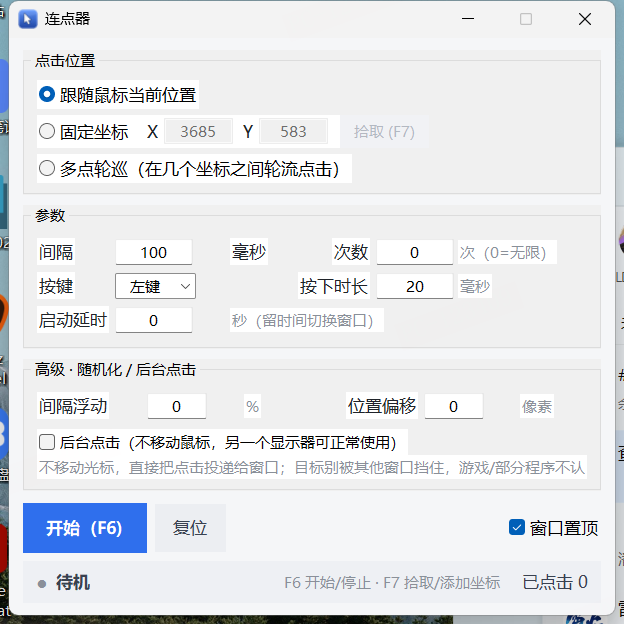
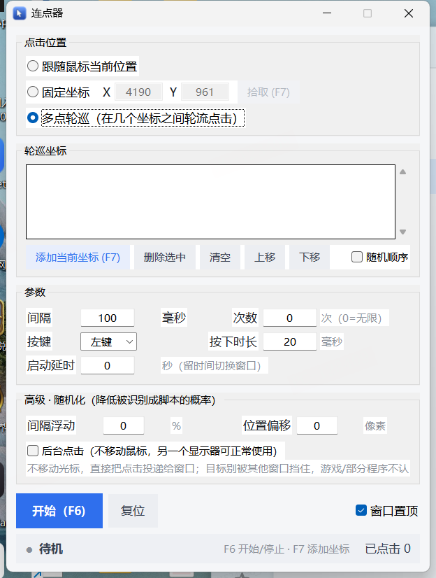

# 连点器 AutoClicker

Windows 桌面连点工具。**单文件 exe，双击即用，不需要安装 Python。**

支持三种点击位置：跟随鼠标、固定坐标、多点轮巡。
间隔、次数、按键、按下时长都能调，另外还带随机化和「后台点击」——不移动鼠标，另一块显示器可以照常使用。

---

## 下载

**[⬇ 下载 AutoClicker.exe](https://github.com/xq1125/AutoClicker/releases/latest/download/AutoClicker.exe)**

下载后放到桌面，双击运行即可。程序是绿色版：不写注册表、不装服务，删掉文件就算卸载。

> 首次启动可能要等 5~10 秒。单文件 exe 需要先解压，还会被杀毒软件扫描一遍，之后就快了。
>
> 如果 Windows 弹出「已保护你的电脑」，点「更多信息 → 仍要运行」即可。这是 exe 没有做代码签名导致的，不是文件损坏。



---

## 功能

- **三种点击位置**
  - 跟随鼠标当前位置（你把鼠标放哪就点哪）
  - 固定坐标（可一键拾取当前鼠标坐标）
  - 多点轮巡（录多个坐标，按顺序或随机轮流点击）
- **参数**：间隔（毫秒）、点击次数（0=无限）、左/右/中键、按下时长、启动延时
- **随机化**：间隔按百分比浮动、坐标随机偏移，让节奏不那么机械
- **后台点击**：不移动系统光标，把点击直接投递给目标窗口，另一块显示器可以正常用鼠标键盘
- **全局热键**：F6 开始/停止、F7 拾取或添加坐标，窗口在后台、最小化时同样有效
- **其它**：窗口置顶、单实例、高 DPI 适配、坐标支持多显示器、参数自动保存

---

## 快速上手

1. 选「跟随鼠标当前位置」；或者选「固定坐标」，再按 **F7** 拾取坐标
2. 填间隔，例如 `100` 毫秒
3. 点「开始 (F6)」；再按一次 **F6** 停止

**多点轮巡**用法：切到「多点轮巡」，把窗口挪开一点，鼠标移到目标位置按 **F7** 加点；录好几个点之后按 F6，就会按 1 → 2 → 3 → 1 的顺序轮流点击。



---

## 热键

| 按键 | 作用 |
| --- | --- |
| `F6` | 开始 / 停止 |
| `F7` | 拾取当前坐标；轮巡模式下添加一个坐标 |

---

## 后台点击说明

勾选「后台点击（不移动鼠标）」之后，程序不再调用系统级鼠标模拟，而是往目标窗口投递点击消息。

- 标准按钮用 `BM_CLICK`，其它控件用 `WM_LBUTTONDOWN / UP`
- **系统光标一步都不动**，所以你可以在另一块显示器上正常操作

需要注意的限制：

1. **目标窗口不能被挡住。** 点击只会发给该坐标最上层的那个窗口。
2. **不是所有程序都认。** 标准 Win32 / WinForms 按钮没问题；游戏、部分 Chromium/Electron 应用、自绘界面的程序可能无视这类消息。
3. **怎么判断兼容性。** 如果状态栏的「已点击」在涨、但目标毫无反应，说明这个程序不支持后台点击；取消勾选改用前台模式即可 —— 前台点击几乎 100% 有效，代价是光标会被占住。

| | 前台模式 | 后台模式 |
| --- | --- | --- |
| 能否点中 | 几乎都能 | 看目标程序 |
| 另一块显示器 | 光标被抢，基本没法用 | 完全不受影响 |

---

## 常见问题

### 点了完全没反应？

目标程序如果是「以管理员身份运行」的，连点器也要右键「以管理员身份运行」。否则 Windows 会拦截模拟输入。

### 杀毒软件报毒？

PyInstaller 打包的 exe 经常被误报，自动化类工具尤其明显。

源码 `autoclicker.py` 完全公开，你可以自己用 `build.bat` 重新打包，也可以直接 `python autoclicker.py` 运行。

### 需要管理员权限吗？

普通程序不需要。只有当目标程序以管理员身份运行时才需要。

### 坐标会偏吗？

程序按物理像素取点和还原，支持多显示器与缩放（125% / 150%）。

如果目标程序自身做了 DPI 缩放，请以实际点击效果为准微调坐标。

---

## 从源码运行

需要 Python 3.9+，自带 tkinter，无第三方依赖：

```bash
python autoclicker.py
```

## 自行打包 exe

```bat
build.bat
```

产物在 `dist\AutoClicker.exe`。

---

## 许可

[MIT](LICENSE)
